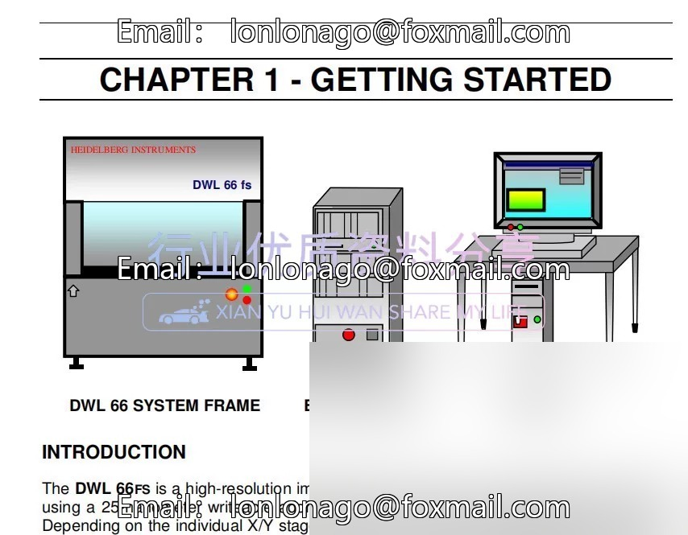
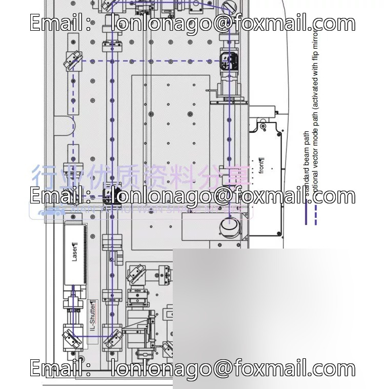
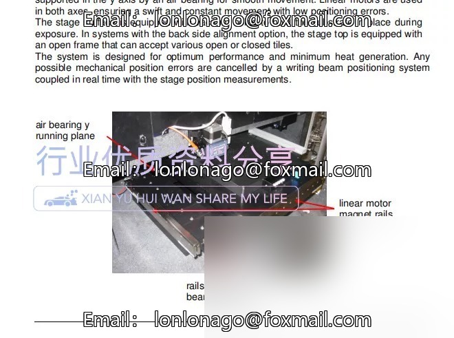
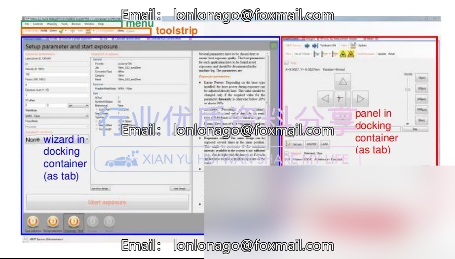
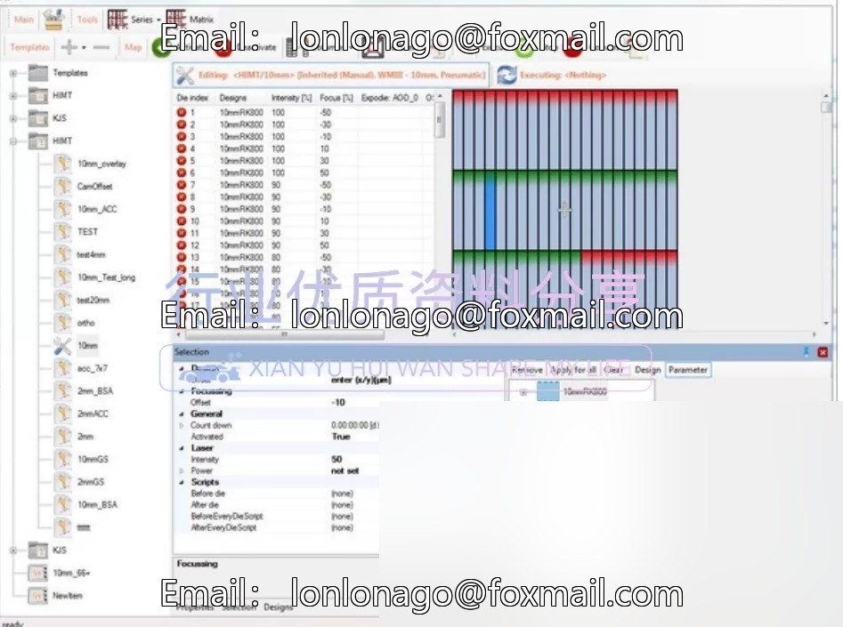
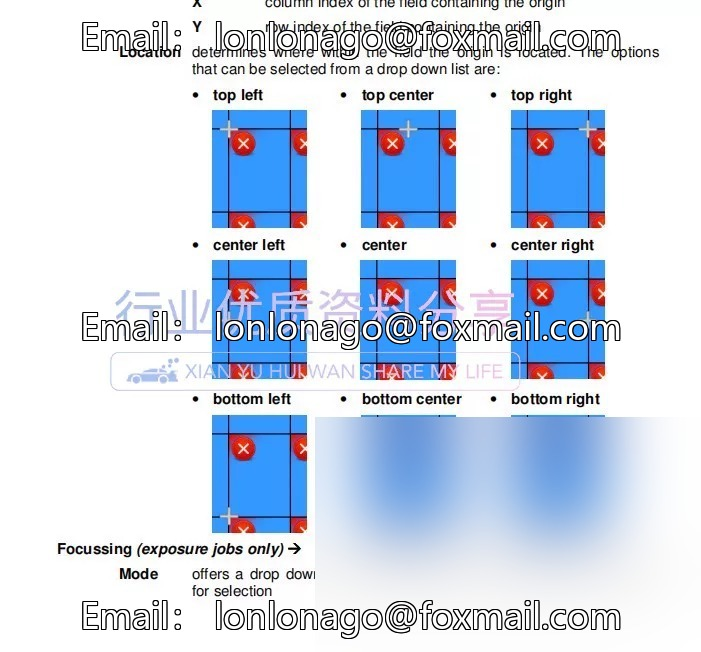
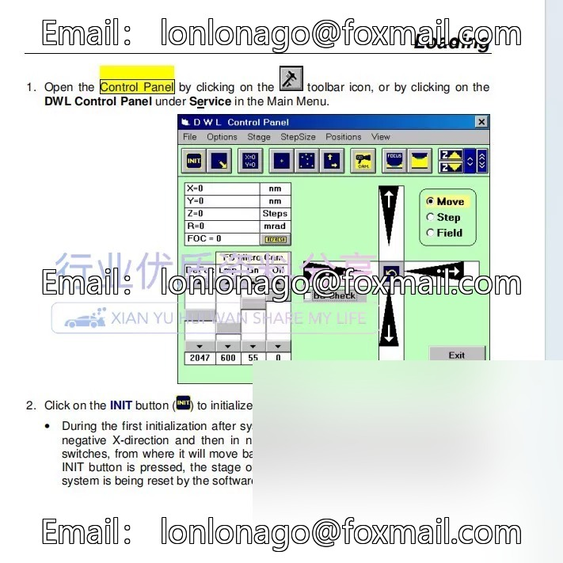
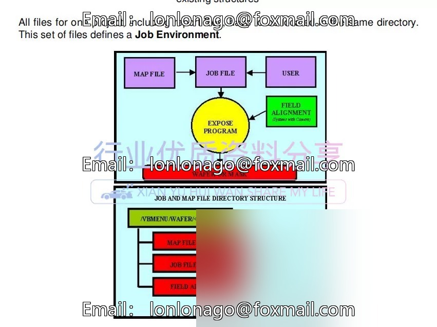

# User manual for the HIDEGEM Research DWL66+ non-masked laser direct write photolithography machine, materials 30

## Body

The user manual for the Heidelberg DWL66+ unfocused laser direct writing lithography machine, with 300 pages of detailed content, including great reference value for device structure descriptions and operation and maintenance methods.

The following are screenshots of some content, and a complete PDF document will be provided upon completion of capture.

Take a photo and directly send the electronic original file! Since the electronic file materials have copyability, it is not allowed to return the purchase for electronic files! Thank you for understanding!

The user manual includes chapter content and screenshots covering device structure, operation and maintenance methods, as well as setup and start procedures.

<!-- AI_ENRICHED -->

## Images

## Payment

Here is a pay link on Stripe ( https://buy.stripe.com/3cs8yP7sY87d0vu9AB ). Please contact me lonlonago@foxmail.com after funding $89, and I will send you a complete data files , thank you!

